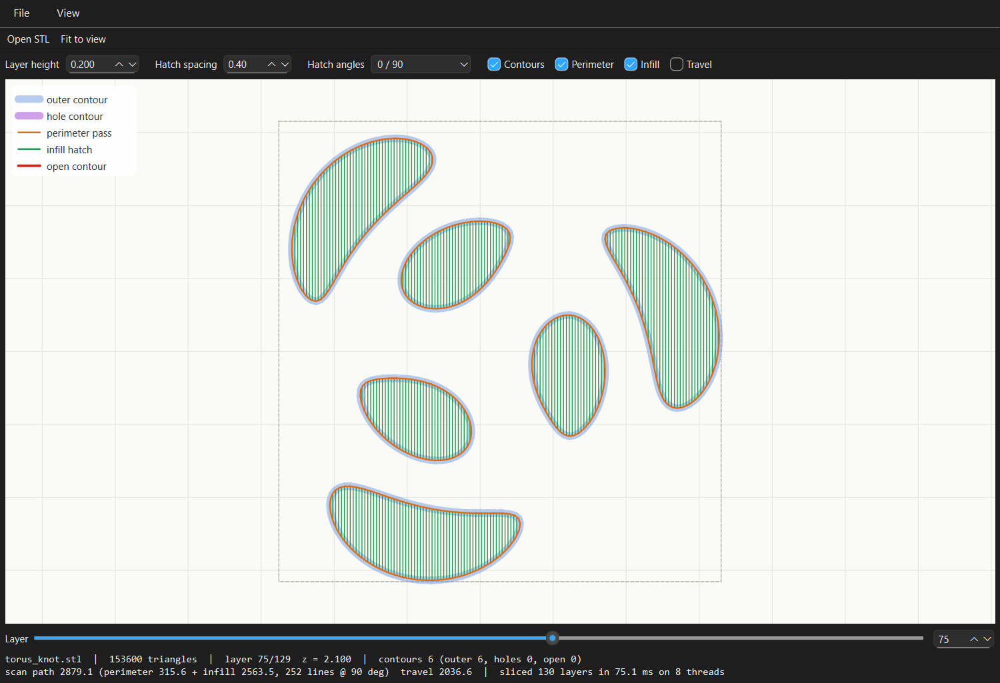
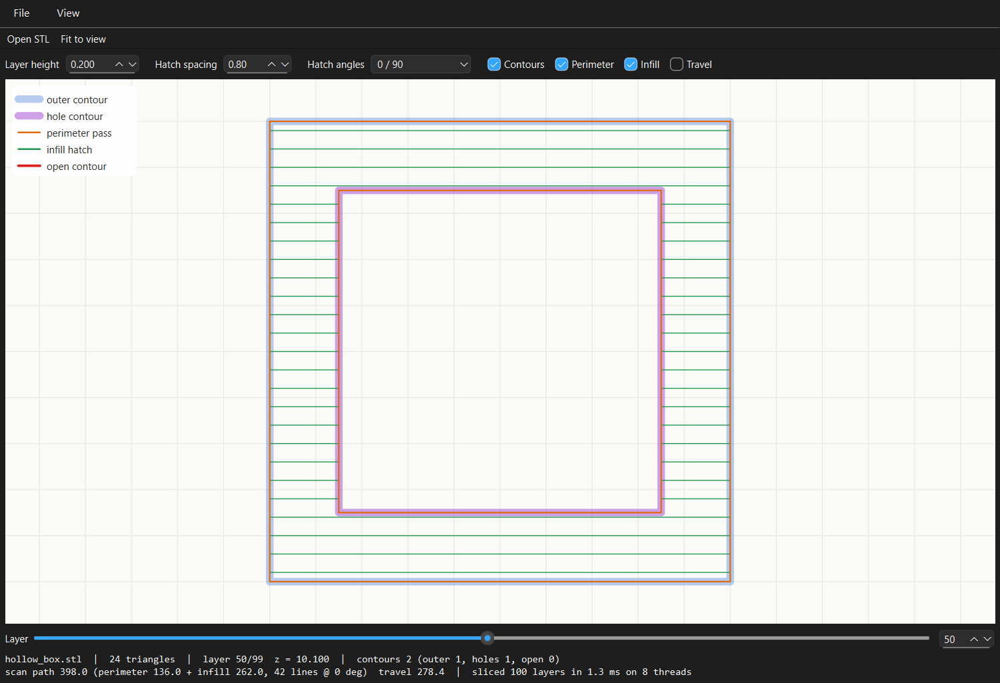
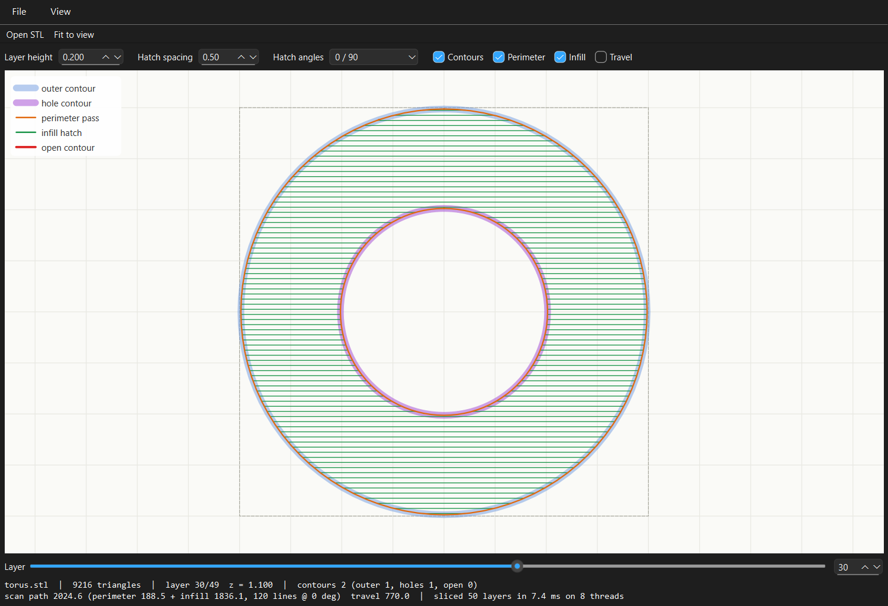
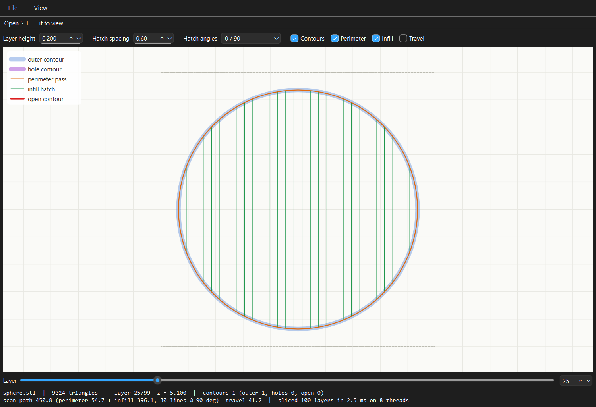

# Layer Slicer

A C++17 tool that slices a 3D triangle mesh (STL) into horizontal layers, builds
closed contours for each layer, produces laser-style scan paths (perimeter pass
plus hatched line infill), and shows the result in a Qt 6 Widgets viewer.

- **Core library** (`layerslicer_core`, no Qt dependency): STL I/O, triangle/plane
  intersection, tolerance-based endpoint merging, hash-map stitching, scanline
  infill, parallel slicing with `std::thread`.
- **`slicer_cli`**: slices a file and prints per-layer stats and timing; `--bench`
  times 1, 2, 4 and 8 threads.
- **`layer_slicer_viewer`**: Qt viewer with a layer slider/spin box, zoom/pan,
  fit-to-view, per-layer info and an offscreen `--screenshot` mode.
- **`gen_models`**: writes the procedural demo and benchmark models.
- **54 tests** (52 GoogleTest cases plus 2 executable smoke tests), all passing.

| Torus knot, 153,600 triangles, layer 75 (90 deg hatch) | Hollow box: outer contour + cavity hole |
|---|---|
|  |  |
| **Torus: annulus with a hole** | **Sphere, layer 25** |
|  |  |

All four screenshots are real output from
`layer_slicer_viewer <model> --layer <n> --screenshot docs/<name>.png`.

## Pipeline

```
STL file ─► Mesh (welded vertices, indexed triangles)
         ─► for each layer z (in parallel):
              triangle ∩ plane  ─► directed segments
              quantise endpoints ─► grid keys (spatial hash)
              stitch via hash map ─► closed contours (+ open ones reported)
              signed area        ─► outer (CCW) / hole (CW)
              perimeter + scanline infill ─► scan paths
```

### 1. STL loading

`loadStl` reads the whole file and decides the format by size: a binary STL is
exactly `84 + 50·n` bytes, where `n` is the little-endian `uint32` at offset 80.
If the size matches, the file is binary **even if its header starts with
`solid`**, which many exporters write. Otherwise a file starting with `solid` is
parsed as ASCII by a strict tokenizer (`facet normal … outer loop … vertex ×3 …
endloop endfacet … endsolid`). Errors such as truncated files, size mismatches,
bad numbers, wrong vertex counts, missing `endsolid` and NaN coordinates throw
`StlError`. ASCII errors include the line number. Numbers are parsed with the
locale-independent `std::from_chars` at 32-bit float precision, so ASCII and
binary versions of the same model load identically.

The triangle soup is turned into an indexed `Mesh` by welding bit-identical
corners with a hash map. Shared vertices are what make the next step exact.

### 2. Triangle/plane intersection and the on-plane vertex rule

Each vertex is classified against the plane `z = h` as **below** (`z < h`) or
**above** (`z >= h`). A vertex lying exactly on the plane counts as *above*.
This is symbolic perturbation: the plane behaves as if it sat at `h - ε`.
Layer heights are never nudged. A triangle is cut only if it has vertices on
both sides, which gives exactly two crossing edges and one segment:

- **Vertex on the plane:** it is used as the exact endpoint (not interpolated),
  and every triangle around it agrees on it.
- **Triangle touching the plane at a single vertex** (e.g. a tetrahedron apex):
  both crossings are that vertex, so the zero-length segment is dropped.
- **Edge lying in the plane:** reported once, by the neighbouring triangle that
  dips below the plane. The triangle on the upper side is entirely "above" and
  contributes nothing, so there are no duplicates.
- **Triangle lying in the plane:** all three vertices are "above", so it
  contributes nothing. The slice is the cross-section just below `h`. Slicing a
  10 mm cube at `z = 0` gives nothing, and at `z = 10` it gives the full square.
  Slicing a stepped block exactly at its step gives the lower, larger section.

Segments are oriented using the triangle's winding. Walking the triangle's edges
in order, the segment starts on the edge that goes above→below and ends on the
edge that goes below→above. For an outward-facing mesh the material is then on
the left, so outer contours come out counter-clockwise and holes clockwise. Each
edge's crossing point is computed with its endpoints in a canonical order (by
vertex index), so the two triangles sharing an edge produce bit-identical points.

Per layer, only triangles with `zmin < h <= zmax` are visited. Triangle ids are
pre-sorted by `zmin`, and a binary search bounds the scan.

### 3. Tolerance merge

Endpoints are quantised to an integer grid key
`(llround(x/tol), llround(y/tol))` with
`tol = 1e-6 × bounding-box diagonal` (`SliceOptions::relativeTolerance`). This
scales with the model, so a 10 mm part and a 10 m part behave the same, and it
stays far above double rounding error (about 1e-16 relative) while far below any
real feature size. Because of the canonical-edge rule above, matching endpoints
are normally identical already. The grid is a safety net for meshes whose
shared vertices differ in the last bits. The grid keys index an open-addressing
hash table (flat arrays, no per-node allocation).

### 4. Stitching (hash map from endpoint to segment)

Each merged point becomes a node. Each segment is an edge `from → to`. A CSR
adjacency list (node → outgoing segment ids) is built from the hash map, so
following a contour is an O(1) lookup per step. Stitching is **O(S) expected**
for S segments: one hash lookup per endpoint, one counting-sort pass to build
the CSR, and each segment is visited once during the walk.

- Chains are walked from nodes with more outgoing than incoming segments first,
  so an open chain is reported whole. Then every remaining segment starts a
  walk, which normally closes into a loop.
- **Open contours are kept** in the output with `closed = false`, counted in
  `Layer::openContours`, and drawn in red by the viewer. They are never silently
  dropped. A cube with one triangle removed produces them, and a test checks this.
- Zero-length and duplicated directed segments are dropped and counted.
- Collinear points within `tol` are removed (a cube slice has 4 corners, not 8).
- The **signed area** (shoelace formula) classifies each closed contour:
  `> 0` is an outer boundary (CCW) and `< 0` is a hole (CW).

### 5. Scan paths

- **Perimeter pass:** traces every closed contour as a closed polyline.
- **Line infill:** contours are rotated by `-θ` so the hatch lines become
  horizontal at `y = (k + ½)·spacing`, on a global grid so lines line up across
  layers. Each contour edge adds its crossings to the scanlines it spans, using
  the half-open rule `(p.y <= y) != (q.y <= y)`, so a line passing through a
  vertex counts exactly one of its two edges. The crossings are sorted per line
  and paired **even-odd** (`[x0,x1], [x2,x3], …`). Spans inside holes are
  therefore excluded automatically. The segments are rotated back, and
  alternate rows are reversed (serpentine) to reduce jumps.
- **Settings:** hatch spacing, optional end inset, and the angle schedule.
  Layer `i` uses `anglesDeg[i % n]`, e.g. `0,90` or `0,45,90,135`.
- **Statistics:** each layer reports perimeter length, infill length and travel
  (laser-off jump) length.

### 6. Parallel slicing

`Slicer::sliceAll(heights, threads)` pre-allocates `std::vector<Layer>
results(n)` and starts N `std::thread`s. Thread `t` processes layers
`t, t+N, t+2N, …`. Cyclic distribution balances the uneven cost of layers
(e.g. the middle of a sphere costs more than its poles). Each thread reads only
immutable shared data (the `std::shared_ptr<const Mesh>` and the sorted z-range
arrays) and writes only to its own result slots, so **there are no locks and no
shared mutable state**. Exceptions are captured in per-thread
`std::exception_ptr` slots and rethrown after `join`. The output is
bit-identical for any thread count, which a test checks.

### Ownership

There is no raw `new`/`delete` in the project code. The mesh is shared as
`std::shared_ptr<const Mesh>` between the `Slicer`, the CLI and the viewer, and
sliced layers are held as `std::shared_ptr<const std::vector<Layer>>`. Everything
else is a value type or a `std::vector`. In the viewer, widgets are owned by
Qt's parent-child hierarchy.

## Building

Requirements: a C++17 compiler, CMake ≥ 3.16 and Ninja (or another generator).
Qt 6 Widgets is needed for the viewer only. GoogleTest is downloaded
automatically with `FetchContent`.

### Windows (Qt 6.8.3 + Qt's MinGW 13.1)

Use the MinGW toolchain that ships with Qt. Another MinGW (e.g. MSYS2) has a
different ABI.

```bash
# Git Bash
export PATH="/e/Qt/Tools/mingw1310_64/bin:/e/tools/aqt-venv/Scripts:$PATH"
cmake -S . -B build -G Ninja -DCMAKE_BUILD_TYPE=Release -DCMAKE_PREFIX_PATH=E:/Qt/6.8.3/mingw_64
cmake --build build
```

`build.sh` does the same with these paths. To run the viewer, put
`E:\Qt\6.8.3\mingw_64\bin` on `PATH` or run `windeployqt build/layer_slicer_viewer.exe`.

### Linux / macOS

```bash
# Ubuntu: sudo apt install cmake ninja-build g++ qt6-base-dev libgl1-mesa-dev
# macOS:  brew install cmake ninja qt
cmake -S . -B build -G Ninja -DCMAKE_BUILD_TYPE=Release   # add -DCMAKE_PREFIX_PATH=$(brew --prefix qt) on macOS
cmake --build build
```

To build without Qt, add `-DLAYER_SLICER_BUILD_VIEWER=OFF`. To skip the tests,
add `-DLAYER_SLICER_BUILD_TESTS=OFF`.

## Running

```bash
./build/gen_models models                       # write cube/sphere/torus/hollow_box/torus_knot STLs
./build/slicer_cli models/sphere.stl --layer-height 0.5 --spacing 0.5 --angles 0,45,90,135
./build/slicer_cli models/torus_knot.stl --bench --layer-height 0.05 --repeat 3
./build/layer_slicer_viewer models/torus.stl    # or File > Open
./build/layer_slicer_viewer models/torus_knot.stl --layer 75 --spacing 0.4 --screenshot shot.png
```

`slicer_cli` prints one row per layer (z, outer/hole/open contour counts,
segments, perimeter, infill and travel length, hatch angle), then totals and
the slicing time. It exits with code 3 if any contour failed to close.

Viewer controls:

- Mouse wheel zooms around the cursor.
- Left- or middle-drag pans.
- Double-click or `F` fits the model to the view.
- The slider or spin box selects the layer.
- Check boxes toggle contours, perimeter, infill and travel moves.
- Layer height, hatch spacing and angle pattern re-slice the model.

`--screenshot` renders the window without showing it on screen, writes the PNG
and exits. On a machine without a display, set `QT_QPA_PLATFORM=offscreen`.

## Models

Every model is built procedurally in code (`src/mesh_gen.cpp`, `apps/gen_models`), so
nothing is downloaded:

| file | triangles | notes |
|---|---:|---|
| `cube.stl` | 12 | 10 mm cube, ASCII |
| `sphere.stl` | 9,024 | r = 10 UV sphere, binary |
| `torus.stl` | 9,216 | R = 15, r = 5, slices contain a hole |
| `hollow_box.stl` | 24 | 20 mm box with a closed 14 mm cavity |
| `torus_knot.stl` | **153,600** | (2,3) torus knot tube, benchmark model (7.7 MB, not committed; `gen_models` recreates it) |

## Testing

```bash
cmake --build build
QT_QPA_PLATFORM=offscreen ctest --test-dir build --output-on-failure
```

There are 52 GoogleTest cases in 14 suites, plus 2 smoke tests that run
`slicer_cli` and the viewer's screenshot mode. All 54 pass. The cases cover:

- **Cube (side 10):** every layer is one CCW square with 4 corners, area 100 and
  perimeter 40. Slicing exactly at `z = 0` gives nothing and no open contours.
  Slicing at `z = 10` gives the square. A subdivided cube is sliced at its
  interior vertex rings (2.5, 5, 7.5), and a shifted box is also checked.
- **Sphere (r = 10, 256×128 UV mesh):** at 10 heights, the contour area is within
  0.2% of `π(r² − z²)`. Slicing exactly at every vertex ring of a 96×48 sphere
  gives closed contours.
- **Degenerate cases:**
  - A tetrahedron sliced through its apex or base gives no contours and no
    broken ones; at mid-height its area is exact.
  - An octahedron sliced through its 4 equator vertices gives a square of area 2.
  - A stepped block sliced at its horizontal step face gives the section below.
  - A hollow box sliced at its cavity floor and ceiling is checked too.
- **Holes:** the hollow box gives an outer contour of area 400 and a hole of
  area −196. The torus equator gives an outer circle and a hole circle.
- **Infill containment:** 49 interior points per infill line are tested with
  even-odd point-in-polygon on the cube, the hollow box and the torus, at
  several angles. No point falls in the cavity or the torus hole. Other checks:
  spacing, coverage (length = area / spacing), inset, serpentine direction,
  angle rotation per layer, and no infill for open contours.
- **Stitching:** the tolerance merges endpoints that are 1e-9 apart. Open chains
  are reported whole. A mesh with a missing triangle reports open contours.
  Duplicate and zero-length segments are dropped.
- **STL:**
  - ASCII and binary round trips (in memory and on disk).
  - A binary file whose header starts with `solid`.
  - CRLF line endings, exponents and signs; empty models.
  - Malformed files: empty, too small, truncated, count mismatch, NaN, missing
    `endsolid`, bad number, 2-vertex loop, truncated facet, error line number,
    missing file.
- **Parallel:** 2, 3, 4, 8 and hardware-concurrency threads give results
  bit-identical to one thread on a torus knot (130 layers). Also checked: more
  threads than layers, an empty height list, and shared mesh ownership.
- **Generators:** every procedural mesh is closed and 2-manifold with positive
  volume, and the analytic volumes match.

## Benchmark

`slicer_cli models/torus_knot.stl --bench --layer-height 0.05 --repeat 3`

- **Model:** torus knot, 153,600 triangles, 520 layers.
- **Timed work:** the full pipeline (intersection, merge and stitch, perimeter
  and infill), 1.27 M segments and 84 k infill lines in total.
- **Method:** each run does a warm-up pass, then 3 interleaved rounds of
  1/2/4/8 threads, and reports the per-thread-count median. The command was run
  3 times, and the table shows the median of the three medians.
- **Machine:** Intel Core i5-10300H (4 cores / 8 threads), Windows 11, Qt MinGW
  13.1 `-O3`. Other processes kept the CPU 55–90% busy during the runs.

| threads | run 1 (ms) | run 2 (ms) | run 3 (ms) | **median (ms)** | speedup |
|---:|---:|---:|---:|---:|---:|
| 1 | 618.5 | 784.5 | 548.6 | **618.5** | 1.00× |
| 2 | 296.3 | 321.3 | 263.7 | **296.3** | 2.09× |
| 4 | 186.3 | 272.2 | 268.4 | **268.4** | 2.30× |
| 8 | 228.9 | 244.0 | 195.3 | **228.9** | 2.70× |

Going from 4 to 8 threads gains little: the CPU has 4 physical cores, so threads
5–8 are hyperthreads, and the background load competed for those cores. An
earlier run on a less loaded machine measured 340 / 222 / 86 / 87 ms (3.9× on 4
threads).

## Layout

```
include/layerslicer/  public headers (mesh, stl_io, intersect, stitch, geometry, paths, slicer, mesh_gen)
src/                  core library
apps/cli/             slicer_cli
apps/viewer/          Qt viewer (MainWindow, SliceView)
apps/gen_models/      model generator
tests/                GoogleTest suite
models/               small demo STLs
docs/                 screenshots
```
